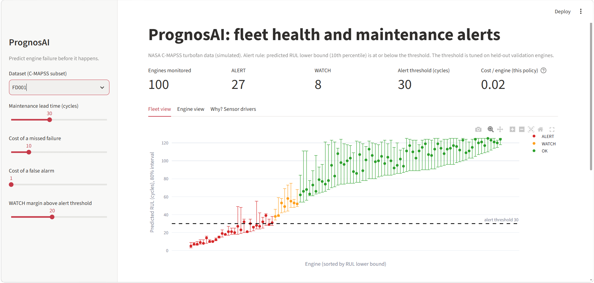
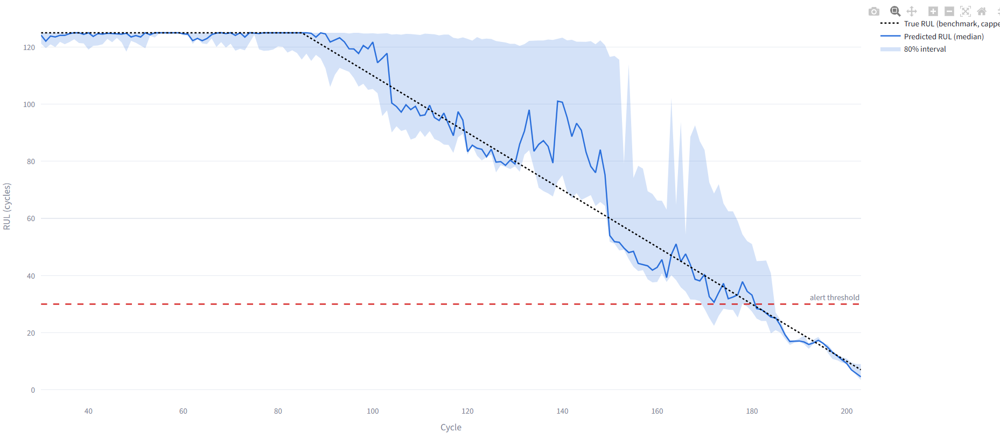
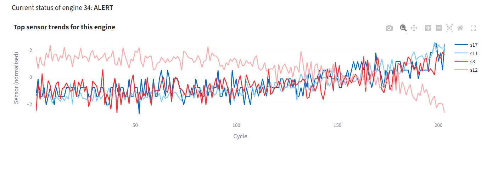

# PrognosAI

*Predict engine failure before it happens: RUL forecasting with uncertainty and cost-based alerts.*

Predictive maintenance on the NASA C-MAPSS turbofan dataset.

Predict remaining useful life (RUL) of turbofan engines from multivariate sensor time series, and turn the predictions into maintenance alerts.

## Status
- [x] Data loading, per-condition normalisation, capped RUL target, windowing, engine-level split
- [x] Metrics: RMSE + NASA asymmetric score
- [x] LightGBM baseline (rolling mean/std/slope features)
- [x] 1D-CNN and GRU on 30-cycle windows (Keras), first pass on FD001 only
- [x] Uncertainty: quantile LightGBM (10th/50th/90th percentile) -> RUL intervals
- [x] Cost-based alert threshold (chosen on validation engines, applied once to test)
- [x] Unit tests + GitHub Actions CI
- [x] Explainability: exact TreeSHAP sensor importance (LightGBM pred_contrib)
- [x] Streamlit dashboard (fleet view, engine view, sensor drivers)
- [x] FastAPI prediction endpoint + Dockerfile

## Run
    pip install -r requirements.txt
    python -m src.baseline FD001
    python -m src.deep FD001 gru 30   # or cnn
    python -m src.quantile FD001      # intervals + alert policies
    python -m src.explain FD001       # sensor importance chart
    streamlit run app/dashboard.py    # interactive dashboard
    python -m pytest -q

Data: NASA C-MAPSS (simulated turbofan run-to-failure data), in data/raw/.

## Results (test set, last window per engine)

| Subset | Model | RMSE | NASA score |
|---|---|---|---|
| FD001 | LightGBM (window features) | 13.3 | 237 |
| FD001 | GRU | 15.7 | 371 |
| FD001 | GRU ensemble (2 seeds) | 15.9 | 348 |
| FD001 | 1D-CNN | 19.0 | 977 |
| FD001 | 0.7 LightGBM + 0.3 GRU blend | 13.5 | 237 |
| FD002 | LightGBM | 26.8 | 8291 |
| FD003 | LightGBM | 14.4 | 338 |
| FD004 | LightGBM | 27.7 | 5561 |

Deep models are untuned first passes (single seed, 80/20 engine split for early stopping). Tuned results will replace these.

## Uncertainty and cost-based alerts (LightGBM quantile models)

Median RMSE is on par with the point model. An alert fires when the predicted RUL (lower bound or median) is at or below a threshold T.
Assumptions: lead time 30 cycles; a missed failure (no alert, true RUL <= 30) costs 10; a false alarm (alert, true RUL > 30) costs 1.
T is tuned on held-out validation engines, never on the test set. Cost is per test engine (lower is better).

| Subset | Median RMSE | 80% interval coverage | Never alert | Always alert | Alert on median | Alert on lower bound (q10) |
|---|---|---|---|---|---|---|
| FD001 | 13.2 | 0.64 | 2.50 | 0.75 | 0.04 | 0.02 |
| FD002 | 26.1 | 0.69 | 2.36 | 0.76 | 0.04 | 0.05 |
| FD003 | 14.9 | 0.70 | 2.00 | 0.80 | 0.02 | 0.02 |
| FD004 | 27.2 | 0.66 | 2.14 | 0.79 | 0.12 | 0.10 |

Limitations:
- The nominal 80% intervals cover only 64-70% of true values, so they are overconfident; calibration (e.g. conformal prediction) is future work.
- Costs and lead time are illustrative assumptions, not real maintenance data, and the test sets have only 100-259 engines, so differences between the two alert policies are small.
- C-MAPSS is simulated data.

## Dashboard

`streamlit run app/dashboard.py` trains the quantile models for the chosen subset (about 15 seconds, cached) and shows:
- **Fleet view:** every engine with predicted RUL, an 80% interval and an ALERT / WATCH / OK status, sorted by the RUL lower bound.
- **Engine view:** predicted RUL over time with its interval against the benchmark ground truth, plus the top sensor trends.
- **Sensor drivers:** which sensors push the predicted RUL up or down (TreeSHAP).
- Sidebar sliders for lead time and the costs of missed failures and false alarms; the alert threshold is re-tuned on validation engines each time.

## API and Docker

A FastAPI service returns RUL, an 80% interval and an alert status for one engine's sensor history.

    # local
    python -m src.train_final FD001          # optional: pre-train and save models (else trains on first request)
    uvicorn api.main:app --reload            # docs at http://127.0.0.1:8000/docs

    # docker (trains all four subsets during the image build)
    docker build -t prognosai .
    docker run -p 8000:8000 prognosai

Endpoints: `GET /health`, `GET /subsets` (lists required columns), `POST /predict`.

Example request body for `POST /predict`: `{"subset": "FD001", "readings": [{"cycle": 1, "op1": -0.0007, "op2": -0.0004, "op3": 100, "s1": 518.67, ... "s21": 23.4190}, ...]}` with one object per cycle, oldest first, and all of `cycle, op1-op3, s1-s21`.
Response: `rul_q10`, `rul_median`, `rul_q90`, `alert_threshold`, `status` (ALERT / WATCH / OK) and a `note` when fewer than 30 cycles are supplied.

Architecture: `data -> per-condition normalisation -> 30-cycle window features -> quantile LightGBM -> interval + cost-tuned threshold -> ALERT/WATCH/OK`, served by the dashboard (Streamlit) or the API (FastAPI).

---

## About the author

**Wadud Ansari**: Computer Engineer, focused on AI/ML and computer vision.

- B.E. Computer Engineering, GPA 3.60 / 4.0, semester topper with an appreciation certificate
- Skills: Python, TensorFlow/Keras, LightGBM, OpenCV, Streamlit, FastAPI, Docker
- Licensed engineer, Nepal Engineering Council (NEC)
- Other work: skin lesion classification with EfficientNet-B3 transfer learning (final year project), and a bilingual Arabic/English RAG assistant

**GitHub:** [github.com/Wadud-Ansari](https://github.com/Wadud-Ansari)
**This project:** [github.com/Wadud-Ansari/PrognosAI](https://github.com/Wadud-Ansari/PrognosAI)

To run it yourself:

    git clone https://github.com/Wadud-Ansari/PrognosAI.git
    cd PrognosAI